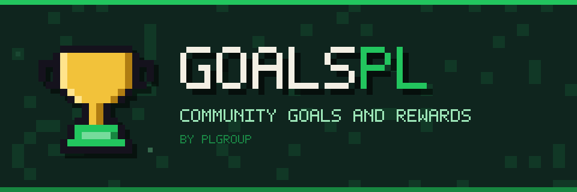

# GoalsPL



Community goals for Paper and Purpur. Staff create shared campaigns from menus and players complete them together: kill mobs, break blocks or hand in materials. Milestones are announced and rewarded along the way, and finishing a campaign can start the next stage automatically.

Documentation: [English](docs/en/GoalsPL%20-%20Documentation%20EN.md), [Español](docs/es/GoalsPL%20-%20Documentaci%C3%B3n%20ES.md).

## Features

- Everything from menus: `/goals` for players and `/goals admin` for staff, with a summary and validation before a campaign goes live.
- Goal types: kill entities, break blocks, deliver materials (through a safe hand-in screen) and manual progress (`/goals progress` or the API).
- Community milestones by percentage (for everyone or only players who reached a minimum), personal milestones, leaderboard rewards, and minimum or maximum contribution per player.
- Rewards: console commands, messages, items, temporary permissions, broadcasts, one-time commands and EventsPL events. Anything that can't be delivered is kept and retried later.
- Duration and/or deadline, worlds where progress counts, a bossbar with progress and time left, configurable announcements.
- SQLite storage with disk work off the main thread, automatic backups and configurable retention.
- Public API with Bukkit events. No NMS and no PacketEvents.

## Requirements

- Paper or Purpur 1.21.4 to 26.3
- Java 21 (Java 25 for 26.x)
- Optional: EventsPL, for `EVENT` rewards

Spigot, CraftBukkit and Folia are not supported.

## Commands

| Command | Permission | Description |
|---|---|---|
| `/goals` | `goalspl.use` | Main menu |
| `/goals goals` | `goalspl.use` | Active campaigns |
| `/goals info <id>`, `/goals top <id>` | `goalspl.use` | Details and leaderboard |
| `/goals contribute <id>` | `goalspl.contribute` | Hand in materials |
| `/goals claim` | `goalspl.use` | Collect pending rewards |
| `/goals admin` | `goalspl.view` | Admin panel |
| `/goals start/pause/resume/complete <id>` | `goalspl.manage` | Control a campaign |
| `/goals cancel <id>` | `goalspl.cancel` | Cancel a campaign |
| `/goals progress <id> <+n/-n/=n> [player]` | `goalspl.progress` | Adjust progress |
| `/goals history [id] [page]` | `goalspl.view` | History |
| `/goals reload` | `goalspl.reload` | Reload files |

`goalspl.manage` also allows creating, editing, cloning and deleting campaigns from the menu. Console command rewards need `goalspl.commands` as well. `goalspl.admin` grants everything.

## Rewards

Written as `TYPE: value`. Variables: `{player}`, `{goal_id}`, `{goal_name}`, `{progress}`, `{goal}`, `{percent}`, `{contribution}`, `{rank}`.

| Type | Value | Given to |
|---|---|---|
| `COMMAND` | command without slash | each player |
| `MESSAGE` | MiniMessage text | each player |
| `ITEM` | `MATERIAL amount` | each player |
| `PERMISSION` | `permission duration` | each player |
| `BROADCAST` | MiniMessage text | once |
| `GLOBAL_COMMAND` | command without slash | once |
| `EVENT` | EventsPL event ID | once |

## API

```java
GoalsAPI api = Bukkit.getServicesManager().load(GoalsAPI.class);
api.running();
api.addProgress("zombie_hunt", uuid, "Steve", 5, "MyPlugin");
```

Events in `com.plgroup.goalspl.api.event`: `CampaignStartedEvent`, `CampaignMilestoneEvent`, `CampaignEndedEvent` and `CampaignContributionEvent` (cancellable).

## Building

```
./mvnw package
```

The jar is written to `target/`.

## License

GoalsPL is made by PLGroup and distributed under the PLGroup License: free to use on any server, all other rights reserved. See [LICENSE](LICENSE.txt).
